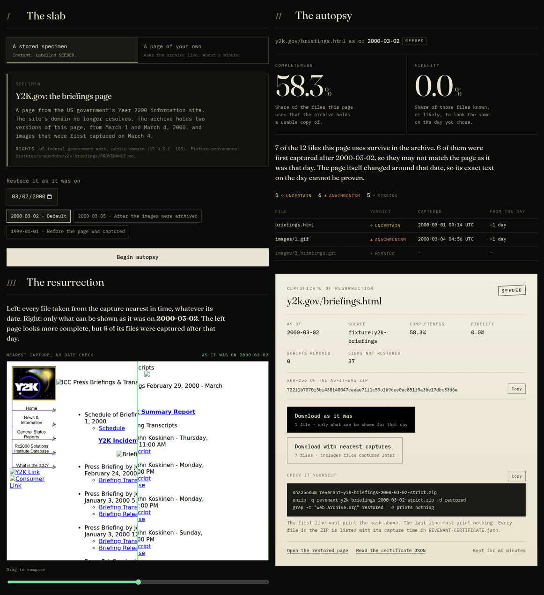
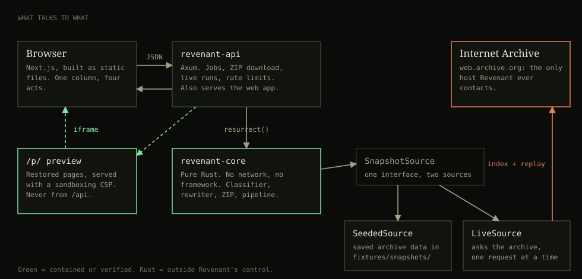
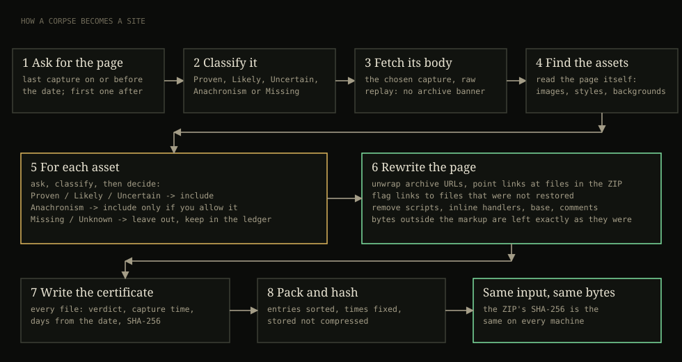
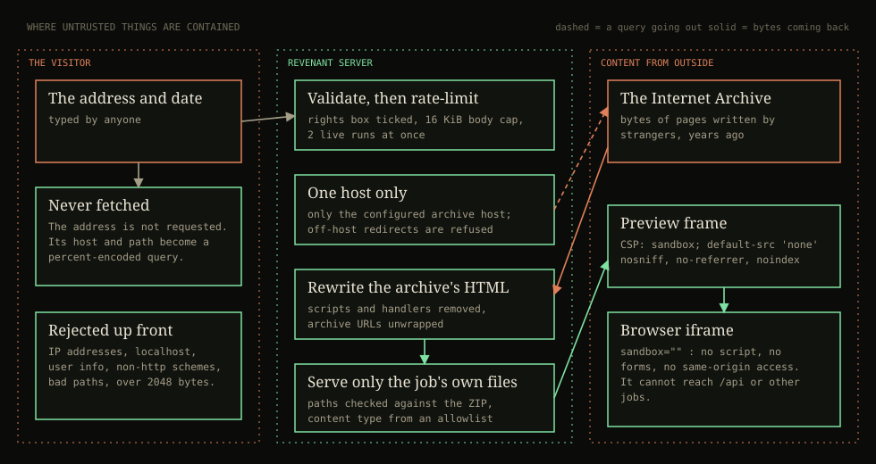

# Revenant

**Bring a dead website back as it was on a day you choose, and see which parts are true.**

Revenant rebuilds a page from the public web archive. Every file in the result carries its capture time, its source, and a fidelity verdict, so you can tell what is original from what is a later stand-in. Kiroween 2026, category **Resurrection**.



## Judge quickstart

1. **Run it.** `docker compose up`, then open <http://localhost:8080>. (Or `docker build -t revenant . && docker run --rm -p 8080:8080 revenant`.)
2. **Try the stored specimen first.** Press *Begin autopsy*, then *Resurrect it*. It is labelled `SEEDED`.
3. **Then try a live one.** Choose *A page of your own*, press *Try the Y2K.gov page, live*, tick the rights box. It asks the real Internet Archive, one question at a time, takes about a minute, and is labelled `LIVE`.
4. **Check the download yourself.** The certificate shows the commands: `sha256sum` must print the hash on screen, and `grep -r "web.archive.org"` on the unzipped files must print nothing.
5. **See how it was built.** [`KIRO_USAGE.md`](KIRO_USAGE.md) maps each of the rules' eight write-up questions to files and dated evidence. `.kiro/` holds the specs, steering, hooks and agents.

Everything is checked by one command: `bash scripts/verify.sh`.

## The problem

When a site dies, the Wayback Machine often holds a copy. But its playback shows pages that never existed in that form. Each file on a page is captured at a different moment, and playback quietly mixes them. A published measurement of 2015 found that at most about one archived page in five was both complete and free of this mixing ([Ainsworth, Nelson and Van de Sompel, *Only One Out of Five Archived Web Pages Existed as Presented*, ACM Hypertext 2015](https://www.cs.odu.edu/~mln/pubs/ht-2015/hypertext-2015-temporal-violations.pdf)).

Tools that "restore a website from the Wayback Machine" already exist and sell well: [RestoreMyWebsite](https://restoremywebsite.com), [WaybackTools](https://www.waybacktools.com), [Archivarix](https://archivarix.com), and open-source mirrors such as [obra/wayback-restorer](https://github.com/obra/wayback-restorer). Several are aimed at SEO and expired-domain work, where a page that looks complete is the goal. Some are careful about provenance: WaybackTools reports gaps, and obra/wayback-restorer can exclude captures after a cutoff date.

Revenant is for the person the site belonged to, or someone who must rely on what it said on a given day. For them a page that looks complete but mixes in files from another year is worse than an honest gap.

## What Revenant does

1. **The slab.** Pick a page and a date.
2. **The autopsy.** Two numbers and a ledger:
   - **Completeness**: the share of the files the page uses that the archive holds a usable copy of.
   - **Fidelity**: the share of those files known, or likely, to look the same on the chosen day.
   - Every file gets a verdict, shown as a word and a shape as well as a color.
3. **The resurrection.** The same page restored two ways over one viewport: with the nearest capture of every file, and with only what can be shown as it was that day.
4. **The certificate.** Download either ZIP, with its SHA-256 and a machine-readable certificate listing every file's capture time and source.

| Verdict | Meaning |
|---|---|
| `PROVEN` | Captured before the date, and the same content was captured again after it. Unchanged across the date. |
| `LIKELY` | Captured before the date, and nothing later contradicts it. |
| `UNCERTAIN` | Captures on both sides of the date differ. It changed in between. |
| `ANACHRONISM` | The only capture is from after the date. |
| `MISSING` | No usable copy. A file archived only as an error page counts as missing. |
| `UNKNOWN` | The archive could not be asked. Kept out of the score. It is not the same as missing. |

## What is new here

- **Time is part of the restore.** The date you choose decides which capture of each file is used, and the result says how far each file is from that date. Cutting off later captures is not new. What I did not find in the tools above is a verdict per file (proven, likely, uncertain, later than the date), or the nearest-capture mix shown beside the as-it-was restore. That comparison is the product.
- **Honest failure.** A failed lookup is `UNKNOWN`, never `MISSING`. Only HTTP 200 captures count. The first real run against the live archive hit this: one image stalled until timeout, and Revenant left it out of the score instead of calling it lost.
- **Content, not labels.** Two archive digests can differ while the bytes are identical. The classifier compares content hashes whenever it has them (requirement R4).
- **No model in the loop.** Every verdict is a deterministic function of capture times and content. The same inputs give the same ZIP, byte for byte.

## Architecture



| Part | Where | What it is |
|---|---|---|
| Engine | `crates/revenant-core` | Pure Rust, no network or framework code. Timestamps, the capture index, the fidelity classifier, the HTML rewriter, the deterministic ZIP, and the pipeline behind a `SnapshotSource` trait. |
| API | `services/api` | Axum. Jobs, ZIP download, sandboxed previews, live runs, rate limits. Serves the built web app. |
| Web | `apps/web` | Next.js, exported as static files. One column, four acts. |
| Fixtures | `fixtures/` | Saved archive data for the stored specimen, with a provenance note and rights basis. |
| Kiro | `.kiro/` | Specs, steering, hooks, custom agents. |

Live runs and seeded runs use the same pipeline. Only the `SnapshotSource` differs. A live run asks the archive for the last capture at or before the date and the first capture after it, for each file, once, and uses that one set of answers for both restores.



## Security



- **The address you type is never fetched.** Its host and path are sent, percent-encoded, as a query to the archive's index. All outgoing requests go to one configured host. Redirects that leave that host are refused. IP addresses, `localhost`, single-label hosts, user info and non-http schemes are rejected before any request.
- **Previews cannot run script or reach the API.** Restored pages are served only under `/p/`, with `Content-Security-Policy: sandbox; default-src 'none'`, `nosniff`, `no-referrer` and `noindex`. Scripts and inline handlers are removed. Only files in a job's own ZIP are served, and content types come from an allowlist. The JSON API never serves restored HTML.
- **ZIPs are safe to open.** Entry paths are validated (no `..`, absolute paths, backslashes or drive prefixes). Counts and bytes are capped.
- **Abuse limits.** Request bodies are capped at 16 KiB. Seeded and live runs have separate rate limits, keyed on an address a client cannot spoof. At most two live runs execute at once. Jobs expire after an hour and are capped by count and by total bytes. Live runs are capped at 40 files and 8 MiB.
- **Politeness.** One archive request at a time, at least 1.2 seconds apart, with a descriptive User-Agent and a single `Retry-After`-aware retry.
- **Rights.** A live run requires ticking a box that says the site is yours or you may restore it. What the archive holds stays the property of its owners.

The `revenant-reviewer` agent in `.kiro/agents/` is configured to attack these boundaries read-only.

## Running

Requirements: Docker, or Rust 1.95 and Node 22 with pnpm 11.

```bash
docker compose up                       # then open http://localhost:8080

# development
cargo run -p revenant-api               # API on :8080
pnpm --dir apps/web install && pnpm --dir apps/web dev   # web on :3000, proxies to the API

# everything
bash scripts/verify.sh                  # format, clippy, 128 Rust tests, web typecheck/lint/build, end to end
bash scripts/verify.sh --quick          # Rust only
```

Settings, all optional: `PORT`, `REVENANT_FIXTURES`, `REVENANT_WEB_DIR`, `REVENANT_TRUST_PROXY=1` with `REVENANT_PROXY_HOPS=<n>` (only behind proxies you control; the client address is read from the right of `X-Forwarded-For`), `REVENANT_FRAME_ANCESTORS`. None is a secret.

## What is real, and what is stored

- **`SEEDED`**: files come from saved copies of archive data in `fixtures/snapshots/`. The dates, digests and bytes are the archive's. Each fixture has a `PROVENANCE.md` with its rights basis.
- **`LIVE`**: files were fetched from the Internet Archive during the run.
- The label comes from the server's `SnapshotSource`, not from the page.
- The stored specimen is part of Y2K.gov, a US federal government site. Its domain no longer resolves. US government works are in the public domain (17 U.S.C. §105).
- Tests for live behavior run against a local fake archive that serves the real fixture and misbehaves on demand (rate limits, 403, 500, off-host redirects, oversize bodies). They never contact the real archive.

## Limitations

- **One page at a time.** Links to other pages are flagged `not restored`, not followed.
- **No scripts.** Restored pages have scripts and inline handlers removed. Behavior that depended on JavaScript is not revived.
- **Stylesheets are not followed.** URLs inside CSS and inline `style` attributes are not rewritten.
- **A verdict is about capture dates.** `ANACHRONISM` means the only capture is later than the date, not that the file did not exist. Revenant does not yet use the origin server's own `Last-Modified` header, which would sharpen this.
- **Live depends on the archive.** It can be slow, refuse requests, or hold nothing. Revenant says so instead of guessing.
- **Jobs are in memory** and expire after an hour. A restart clears them.

## Roadmap

Following links to restore a few pages of one site at a time, with the date held fixed across pages. Using the origin's `Last-Modified` header as a second signal. A second archive behind the same trait (Arquivo.pt answers the same index queries). A tool server so Kiro can restore a page conversationally. Link-rot watching that saves a page before it dies.

## Hackathon notes

- **Category:** Resurrection. Dead pages are brought back from the archive. The same engine fits Frankenstein (archive index, content hashing, an HTML rewriter and a sandboxed viewer stitched together), but the story is a resurrection.
- **Prior work:** none. The repository was created on 2026-11-11, inside the submission period. Dependencies are listed in `Cargo.toml` and `apps/web/package.json`.
- **Not used:** Kiro Crew and Kiro powers. [`KIRO_USAGE.md`](KIRO_USAGE.md) says what was used and what was not.

## License

MIT. See [`LICENSE`](LICENSE).
